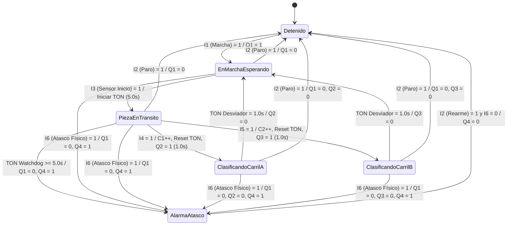

# Documento Técnico — Proyecto 2: Banda Transportadora con Clasificación de Piezas

**Asignatura:** Diseño Digital (III PAC - 2026)  
**Docente:** Ing. Carlos Perdomo  
**Plataforma Objetivo:** Siemens LOGO! (`LOGO!Soft Comfort` — Lenguaje FBD) + Gemelo Digital SoftPLC (`.NET 10` + `SignalR` + `React / Three.js`)

---

## 1. Descripción Funcional del Sistema

El sistema automatiza una **estación industrial de transporte y clasificación selectiva de piezas** en dos categorías (**Categoría A: piezas metálicas/altas** y **Categoría B: piezas poliméricas/bajas**), supervisando además condiciones de atasco para garantizar una operación segura.

### 1.1 Secuencia de Operación Normal
1. **Arranque (`I1`):** Al presionar el pulsador de **Marcha (`I1`)**, si no existe ninguna falla activa, el controlador enclava la memoria de marcha y activa el contactor del **Motor de la Banda (`Q1`)**. La banda transportadora comienza a desplazarse de forma continua.
2. **Detección de Entrada (`I3`):** Cuando una pieza ingresa a la línea, interrumpe el haz del **Sensor Fotoeléctrico de Presencia Inicial (`I3`)**. El PLC registra que hay una pieza en tránsito y arranca un **temporizador de supervisión (`Watchdog TON = 5.0 s`)**.
3. **Clasificación Selectiva (`I4` / `I5`):**
   * **Si la pieza es Categoría A:** Al llegar a la primera estación, activa el **Sensor de Clasificación A (`I4`)**. El PLC detiene y reinicia el Watchdog de tránsito, incrementa en `+1` el **Contador de Categoría A (`C1 / B003`)** y energiza durante **`1.0 s`** el **Solenoide del Cilindro Desviador A (`Q2`)**, expulsando la pieza por la rampa hacia el Colector 01.
   * **Si la pieza es Categoría B:** La pieza rebasa la primera estación sin activar `I4` y llega a la segunda estación, activando el **Sensor de Clasificación B (`I5`)**. El PLC reinicia el Watchdog, incrementa en `+1` el **Contador de Categoría B (`C2 / B004`)** y energiza durante **`1.0 s`** el **Solenoide del Cilindro Desviador B (`Q3`)**, desviando la pieza hacia el Colector 02.
4. **Ciclo Continuo y Paro Controlado (`I2`):** Una vez retraído el cilindro correspondiente (`1.0 s`), la estación queda lista para recibir la siguiente pieza en `I3`. El operador puede detener la línea en cualquier momento presionando el botón de **Paro (`I2`)**, sin perder el conteo acumulado de producción.

### 1.2 Condiciones de Falla y Excepción (Seguridad Industrial)
El sistema contempla **dos mecanismos independientes de detección de atasco**:
1. **Atasco por Tiempo Excedido (Watchdog `TON` = `5.0 s`):** Si una pieza cruza el sensor de inicio `I3` pero no alcanza ninguno de los sensores de clasificación (`I4` o `I5`) dentro de `5.0 segundos`, el controlador asume que la pieza se obstruyó o cayó a mitad de la banda.
2. **Atasco Físico Directo (`I6`):** Activación directa de un sensor de obstrucción/sobrecarga ubicado sobre la zona crítica de transporte.

**Respuesta segura ante falla:**
* Desenergiza de inmediato el **Motor de la Banda (`Q1 = 0`)**.
* Bloquea ambos cilindros desviadores (**`Q2 = 0`, `Q3 = 0`**).
* Enclava la salida de **Alarma de Atasco (`Q4 = 1`)**, encendiendo la torreta luminosa roja y la sirena bitonal en el HMI.
* **Enclavamiento de seguridad:** La línea no puede reanudar la marcha con `I1` hasta que el operador despeje la obstrucción física (`I6 = 0`) y presione explícitamente el botón de **Paro / Rearme (`I2`)**.

---

## 2. Lista Oficial de Entradas, Salidas y Bloques (Tabla de Direccionamiento I/O)

Esta tabla mantiene correspondencia exacta 1 a 1 entre el programa FBD en **LOGO!Soft Comfort** y el backend **SoftPLC** ([`ConveyorPlcState.cs`](file:///c:/Users/HARSOFACE/Documents/GitHub/ProyectoPLC/BackEnd/SoftPlc/Models/ConveyorPlcState.cs)).

### 2.1 Entradas Digitales (`I`)
| Dirección Física | Nombre Simbólico | Variable en SoftPLC (.NET) | Tipo de Contacto | Descripción Funcional |
| :---: | :--- | :--- | :--- | :--- |
| **`I1`** | `S_MARCHA` | `I1_Marcha` | Pulsador NA | Inicia el movimiento de la banda transportadora (si no hay alarma activa). |
| **`I2`** | `S_PARO_REARME` | `I2_Paro` | Pulsador NC / NA | Detiene la banda en operación normal y rearma/limpia el enclavamiento de falla. |
| **`I3`** | `B1_PRESENCIA_INICIO` | `I3_SensorPresenciaInicio` | Sensor Óptico NA | Detecta el ingreso de una pieza a la zona de transporte e inicia el Watchdog. |
| **`I4`** | `B2_DETECTOR_CAT_A` | `I4_SensorClasificacionA` | Sensor Óptico/Inductivo NA | Detecta pieza Categoría A y dispara la secuencia del desviador A. |
| **`I5`** | `B3_DETECTOR_CAT_B` | `I5_SensorClasificacionB` | Sensor Óptico NA | Detecta pieza Categoría B y dispara la secuencia del desviador B. |
| **`I6`** | `S_ATASCO_FISICO` | `I6_SensorAtasco` | Interruptor / Sensor NA | Detecta obstrucción física inmediata en la banda transportadora. |
| **`I7`** *(Opc. LOGO!)* | `S_RESET_CONTADORES` | `ResetCounters()` (HMI) | Pulsador NA | Pone en cero los contadores acumulados de Categoría A y Categoría B. |

### 2.2 Salidas Digitales (`Q`)
| Dirección Física | Nombre Simbólico | Variable en SoftPLC (.NET) | Elemento de Campo | Descripción Funcional |
| :---: | :--- | :--- | :--- | :--- |
| **`Q1`** | `K1_MOTOR_BANDA` | `Q1_MotorBanda` | Contactor Motor `M1` | Energiza el motorreductor que mueve la banda transportadora. |
| **`Q2`** | `Y1_DESVIADOR_A` | `Q2_DesviadorCarrilA` | Electroválvula Cilindro A | Extiende el pistón neumático A durante `1.0 s` hacia el Colector 01. |
| **`Q3`** | `Y2_DESVIADOR_B` | `Q3_DesviadorCarrilB` | Electroválvula Cilindro B | Extiende el pistón neumático B durante `1.0 s` hacia el Colector 02. |
| **`Q4`** | `H1_ALARMA_ATASCO` | `Q4_AlarmaAtasco` | Baliza Roja + Sirena | Señaliza condición de falla/atasco; permanece enclavada hasta rearme (`I2`). |

### 2.3 Bloques Especiales y Memorias Internas
| Identificador | Tipo en LOGO! FBD | Parámetro / Función | Equivalente en SoftPLC (.NET) |
| :---: | :--- | :--- | :--- |
| **`SF01`** | Relé Autoenclavador (`RS`) | Memoria de Sistema en Marcha | `EstadoActual != Detenido && != AlarmaAtasco` |
| **`SF02` / `M2`** | Relé Autoenclavador (`RS`) + Marca | Memoria de Pieza en Tránsito | `EstadoBanda.PiezaEnTransito` |
| **`SF03` / `M1`** | Relé Autoenclavador (`RS`) + Marca | Enclavamiento de Falla/Atasco | `EstadoBanda.AlarmaAtasco` |
| **`B001`** | Temporizador `TON` (Ret. Conexión) | `T = 5.00 s` (Watchdog Tránsito) | `TiempoActualTransitoSeg` / `TiempoMaximoTransitoSeg` |
| **`B002`** | `TOF` (Retardo Desconexión) | `T = 1.00 s` (Pulso Pistón A, con Reset) | `TiempoActualDesviadorSeg` (`ClasificandoCarrilA`) |
| **`B003`** | `TOF` (Retardo Desconexión) | `T = 1.00 s` (Pulso Pistón B, con Reset) | `TiempoActualDesviadorSeg` (`ClasificandoCarrilB`) |
| **`B004` (`C1`)** | Contador Ascendente (`Up/Down`) | Acumulador Piezas Categoría A | `ContadorCategoriaA` |
| **`B005` (`C2`)** | Contador Ascendente (`Up/Down`) | Acumulador Piezas Categoría B | `ContadorCategoriaB` |

---

## 3. Diagrama de Estados de la Secuencia de Operación

---

## 4. Arquitectura del Gemelo Digital (Implementación Real)

Debido a que el simulador offline de **LOGO!Soft Comfort** ejecuta su lógica de bloques en un entorno cerrado sin abrir puertos de red externos (ni Modbus TCP `502` ni S7 `102`), el proyecto implementa una **arquitectura dual**:

1. **Programa FBD en LOGO!Soft Comfort:** Cumple íntegramente el diseño en Diagrama de Bloques de Función y valida la lógica mediante el simulador oficial de Siemens.
2. **Gemelo Digital Interactivo (SoftPLC + HMI SCADA):**
   * **Backend (`BackEnd/SoftPlc` — C# .NET 10):** [`ConveyorPlcService.cs`](file:///c:/Users/HARSOFACE/Documents/GitHub/ProyectoPLC/BackEnd/SoftPlc/Services/ConveyorPlcService.cs) ejecuta un `BackgroundService` con ciclo de scan determinístico cada **`100 ms`**, replicando exactamente los estados, enclavamientos, temporizadores `TON` y contadores descritos en la Sección 2.
   * **Comunicación Tiempo Real:** [`PlcHub.cs`](file:///c:/Users/HARSOFACE/Documents/GitHub/ProyectoPLC/BackEnd/SoftPlc/Hubs/PlcHub.cs) expone WebSockets vía **SignalR** en `/plchub`, recibiendo señales de sensores (`SendSensorSignal`) y emitiendo la instantánea completa del PLC cada ciclo de scan (`ReceivePlcState`).
   * **Frontend (`FrontEnd/src` — React + TypeScript + Three.js):** Interfaz HMI bajo estética **SIMATIC / ISA-101** con selector entre **Gemelo 3D interactivo** ([`Conveyor3DStage.tsx`](file:///c:/Users/HARSOFACE/Documents/GitHub/ProyectoPLC/FrontEnd/src/components/Conveyor3DStage.tsx)), **Sinóptico P&ID 2D** ([`Conveyor2DStage.tsx`](file:///c:/Users/HARSOFACE/Documents/GitHub/ProyectoPLC/FrontEnd/src/components/Conveyor2DStage.tsx)), **Vista Dual**, pupitre de operador IEC 60947, bornera DIO 24VDC, telemetría de bloques FBD y sintetizador de audio industrial ([`industrialAudio.ts`](file:///c:/Users/HARSOFACE/Documents/GitHub/ProyectoPLC/FrontEnd/src/utils/industrialAudio.ts)).
